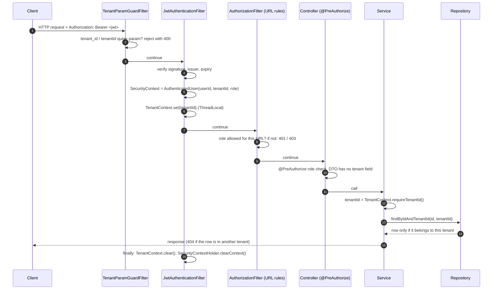

# Multi-Tenant Task Management System

A Spring Boot backend for a SaaS-style task manager. Multiple organizations (tenants) share **one codebase and one H2 database**, and no tenant can ever see or change another tenant's data.

Isolation is enforced at every layer: JWT, security filter, request validation, service, repository, entity and database.

## Tech stack

| Area | Choice |
|---|---|
| Language | Java 17 (compiled with `--release 17`, also runs on 21) |
| Framework | Spring Boot 3.3.5, Spring Web, Spring Data JPA, Bean Validation |
| Security | Spring Security 6 (stateless), custom `OncePerRequestFilter`, method security |
| JWT | jjwt 0.12.6, HS256 |
| Database | H2, single file-based database (`./data/taskdb`), one schema |
| Passwords | BCrypt |
| Tests | JUnit 5, MockMvc, Mockito, Spring Security Test, JaCoCo (80% gate) |

## Running the application

**Prerequisite:** JDK 17 or newer. Maven is not required because the wrapper is included.

```bash
# Windows
mvnw.cmd spring-boot:run

# macOS / Linux
./mvnw spring-boot:run
```

The API runs on `http://localhost:8080`.

To build and run the jar:

```bash
./mvnw clean package
java -jar target/multi-tenant-task-manager-1.0.0.jar
```

**Optional environment variables**

| Variable | Default | Purpose |
|---|---|---|
| `JWT_SECRET` | dev-only value | HS256 signing key, at least 32 bytes. Always set this outside local dev. |
| `JWT_EXPIRATION_MINUTES` | `60` | Token lifetime |
| `PORT` | `8080` | HTTP port |

**H2 console:** open `http://localhost:8080/h2-console` and connect with:

- JDBC URL: `jdbc:h2:file:./data/taskdb;AUTO_SERVER=TRUE`
- User: `sa`
- Password: leave empty

To start with an empty database, stop the app and delete the `data/` folder.

## Running the tests and coverage

```bash
./mvnw clean verify
```

This runs 78 tests and then the JaCoCo coverage check. The build **fails if line or instruction coverage drops below 80%**. Current coverage is about 99% of lines and 98% of instructions. The HTML report is written to `target/site/jacoco/index.html`.

| Test class | Type | What it covers |
|---|---|---|
| `TenantApiTest` | API (MockMvc) | `POST /tenant/register`: success, duplicate name and email, validation, `tenant_id` in the body, malformed JSON |
| `AuthApiTest` | API | `POST /auth/login`: JWT claims, wrong password, unknown email, validation |
| `UserApiTest` | API | `POST /users` and `GET /users`: role checks, 401, duplicate email, `tenant_id` in the body or query, tenant-scoped listing |
| `TaskApiTest` | API | All `/tasks` endpoints: every role, cross-tenant create, assign, status and list attacks; missing, garbage, forged and expired JWTs |
| `JwtServiceTest` | Unit | Token round trip, wrong key, expiry, missing claims, wrong issuer |
| `TenantContextTest` | Unit | ThreadLocal set, clear and per-thread isolation; entity cross-tenant write guard |
| `TaskServiceTest` | Unit (Mockito) | Service always queries with the tenant from the context; ownership checks |

## API

| Method | Path | Roles | Description |
|---|---|---|---|
| POST | `/tenant/register` | public | Creates a tenant and its first ADMIN user |
| POST | `/auth/login` | public | Returns a JWT that contains `tenant_id` and `role` |
| POST | `/users` | ADMIN | Creates a user (ADMIN, MANAGER or USER) in the caller's tenant |
| GET | `/users` | ADMIN, MANAGER | Lists users in the caller's tenant, for example so a manager can find assignee ids. This endpoint was added beyond the spec. |
| POST | `/tasks` | MANAGER | Creates a task in the caller's tenant, with an optional `assignedTo` |
| PUT | `/tasks/{id}/assign` | MANAGER | Assigns a task to a USER in the same tenant |
| PUT | `/tasks/{id}/status` | USER | Updates the status of a task assigned to the caller |
| GET | `/tasks` | USER, MANAGER, ADMIN | ADMIN and MANAGER get all tasks in their tenant. USER gets only tasks assigned to them. |

Task status values are `TODO`, `IN_PROGRESS` and `DONE`. A new task always starts as `TODO`.

### Example calls

```bash
# 1. Register a tenant (this also creates its ADMIN)
curl -X POST localhost:8080/tenant/register -H "Content-Type: application/json" \
  -d '{"tenantName":"Acme","adminEmail":"admin@acme.test","adminPassword":"Password@123"}'

# 2. Log in
curl -X POST localhost:8080/auth/login -H "Content-Type: application/json" \
  -d '{"email":"admin@acme.test","password":"Password@123"}'
# -> {"accessToken":"eyJ...","tokenType":"Bearer","expiresIn":3600,"userId":1,"tenantId":1,"role":"ADMIN"}

# 3. As ADMIN, create a manager and a user
curl -X POST localhost:8080/users -H "Authorization: Bearer $ADMIN_TOKEN" -H "Content-Type: application/json" \
  -d '{"email":"manager@acme.test","password":"Password@123","role":"MANAGER"}'
curl -X POST localhost:8080/users -H "Authorization: Bearer $ADMIN_TOKEN" -H "Content-Type: application/json" \
  -d '{"email":"user@acme.test","password":"Password@123","role":"USER"}'

# 4. As MANAGER, create a task and assign it
curl -X POST localhost:8080/tasks -H "Authorization: Bearer $MANAGER_TOKEN" -H "Content-Type: application/json" \
  -d '{"title":"Prepare Q3 report","description":"Numbers for the board"}'
curl -X PUT localhost:8080/tasks/1/assign -H "Authorization: Bearer $MANAGER_TOKEN" -H "Content-Type: application/json" \
  -d '{"userId":3}'

# 5. As USER, update the status
curl -X PUT localhost:8080/tasks/1/status -H "Authorization: Bearer $USER_TOKEN" -H "Content-Type: application/json" \
  -d '{"status":"IN_PROGRESS"}'

# 6. List tasks (the result depends on the caller's role)
curl localhost:8080/tasks -H "Authorization: Bearer $USER_TOKEN"
```

### Error format

Every error uses the same JSON shape:

```json
{
  "timestamp": "2026-11-22T06:42:41.285Z",
  "status": 404,
  "error": "Not Found",
  "message": "Task not found",
  "path": "/tasks/1/assign"
}
```

Validation errors also include a `fieldErrors` object. Status codes used: `400` (validation, malformed body, or a client-supplied tenant id), `401` (missing, invalid or expired token), `403` (wrong role), `404` (not found, including anything that belongs to another tenant), `409` (duplicate tenant name or email).

## JWT structure and claims

Tokens are signed with **HS256** using `JWT_SECRET`. This is a real token issued by the running app:

**Header**

```json
{ "alg": "HS256" }
```

**Payload**

```json
{
  "iss": "multi-tenant-task-manager",
  "sub": "7",
  "tenant_id": 3,
  "role": "ADMIN",
  "email": "admin.1795329761@demo.test",
  "iat": 1795329761,
  "exp": 1795333361
}
```

| Claim | Meaning |
|---|---|
| `iss` | Issuer. It must equal `multi-tenant-task-manager`; any other value is rejected. |
| `sub` | User id |
| `tenant_id` | **Custom claim.** The tenant the user belongs to. This is the only source of tenant identity in the whole application. |
| `role` | **Custom claim.** `ADMIN`, `MANAGER` or `USER`. It becomes the Spring authority `ROLE_<role>`. |
| `email` | Custom claim, for logging and display |
| `iat` / `exp` | Issued-at and expiry times. The default lifetime is 60 minutes. |

Because the token is signed, a client cannot change `tenant_id` or `role` without invalidating the signature. A test splices tenant B's payload onto tenant A's signature, and the request is rejected with 401.

## Security filter flow



Step by step:

1. **`TenantParamGuardFilter`** (a `OncePerRequestFilter`) rejects any `tenant_id` or `tenantId` query or form parameter with 400.
2. **`JwtAuthenticationFilter`** (a `OncePerRequestFilter`) reads the `Bearer` token and verifies it with `JwtService`. It then:
   - puts an `AuthenticatedUser(userId, tenantId, email, role)` principal into the **SecurityContext**, and
   - binds `tenantId` to **`TenantContext`**, a ThreadLocal, so the tenant is available for the rest of the request.

   If the token is invalid, the request stays unauthenticated and protected endpoints return 401 with `"Invalid or expired token"`. In a `finally` block, both contexts are always cleared, so a pooled thread cannot carry one tenant into the next request.
3. **URL authorization** in `SecurityConfig` maps each endpoint to its roles.
4. **`@PreAuthorize`** on each controller method repeats the role check as defense in depth.
5. **JSON 401 and 403** responses come from `RestAuthenticationEntryPoint` and `RestAccessDeniedHandler`.

## How tenant isolation is achieved

| # | Layer | Mechanism | Where |
|---|---|---|---|
| 1 | Token | `tenant_id` and `role` exist only inside a signed JWT. They cannot be forged or changed. | `JwtService` |
| 2 | Filter | The tenant is resolved **only** from the verified JWT, stored in the SecurityContext and `TenantContext`, and cleared after every request | `JwtAuthenticationFilter`, `TenantContext` |
| 3 | Request | Request DTOs have no tenant field. Jackson `fail-on-unknown-properties` turns `tenant_id` in a body into a 400. `TenantParamGuardFilter` does the same for query parameters. A client-supplied tenant is **rejected loudly, not silently ignored**. | `*Dtos`, `application.yml`, `TenantParamGuardFilter`, `GlobalExceptionHandler` |
| 4 | Service | Every service method gets the tenant from `TenantContext.requireTenantId()`. Assignees are looked up inside the tenant (`findByIdAndTenantId`) and must have role USER. | `TaskService`, `UserService` |
| 5 | Repository | Repositories extend Spring Data's bare `Repository<T, ID>`, **not** `JpaRepository`, so unscoped methods like `findAll()`, `findById()` and `deleteById()` do not exist. Every query method takes a `tenantId`. | `TaskRepository`, `UserRepository` |
| 6 | Ownership | Updates load the entity with tenant and ownership in the same query, for example `findByIdAndTenantIdAndAssignedToId` for status changes. A row from another tenant is simply not found. | `TaskService` |
| 7 | Entity | `TenantScopedEntity` has `@PrePersist`/`@PreUpdate` hooks that refuse to write a row with a null `tenant_id`, or with a `tenant_id` that differs from the request's tenant. `Task.assignTo()` refuses an assignee from another tenant. | `TenantScopedEntity`, `Task` |
| 8 | Database | `tenant_id NOT NULL` and `updatable = false` on `users` and `tasks`, with indexes on `tenant_id` and `(tenant_id, assigned_to)`. One H2 database and one schema. | Entities |
| 9 | Responses | Accessing another tenant's task or user returns **404, not 403**, so a caller cannot even confirm that the id exists. | `TaskService` |

### Design decisions

- **Email is globally unique.** Login takes only email and password, and the tenant is derived from the user record. This avoids asking the client for a tenant at login, which would conflict with "tenant only from JWT". `UserRepository.findByEmail` and `existsByEmail` are the only two queries without a tenant filter. Both are documented as pre-authentication only, and `existsByEmail` returns just a boolean.
- **The `tenants` table** uses `id` as the tenant key. Every tenant-owned table (`users`, `tasks`) has a `tenant_id` column.
- **Tasks can only be assigned to users with role USER.** Only USER can call `PUT /tasks/{id}/status`, so assigning a task to a MANAGER or ADMIN would leave it with nobody able to progress it.
- **Login uses roughly constant time.** When the email is unknown, BCrypt still runs against a dummy hash, so response time does not reveal which emails exist.
- **The JWT is trusted until it expires.** The filter does not query the database on every request. A user's role change takes effect at their next login. A production system would add short expiries or refresh tokens and a revocation list.

## Project structure

```
src/main/java/com/techpulse/taskmanager
├── TaskManagerApplication.java
├── config/SecurityConfig.java              filter chain, URL role rules, BCrypt, Clock
├── security/
│   ├── JwtService.java                     issue and verify JWT (tenant_id, role claims)
│   ├── JwtAuthenticationFilter.java        OncePerRequestFilter: JWT -> SecurityContext + TenantContext
│   ├── TenantParamGuardFilter.java         OncePerRequestFilter: rejects tenant_id query params
│   ├── TenantContext.java                  ThreadLocal tenant holder
│   ├── AuthenticatedUser.java              principal (userId, tenantId, email, role)
│   ├── JwtProperties.java                  jwt.* config, validated at startup
│   └── RestAuthenticationEntryPoint / RestAccessDeniedHandler   JSON 401 / 403
├── common/                                 TenantScopedEntity, ApiException, GlobalExceptionHandler, ErrorResponse
├── tenant/                                 Tenant entity, register endpoint
├── auth/                                   login endpoint
├── user/                                   User entity, Role, users endpoints
└── task/                                   Task entity, TaskStatus, tasks endpoints
```
